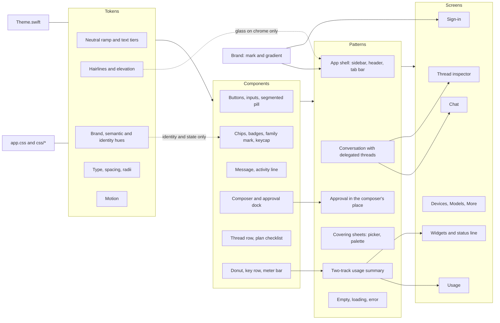

# Grouper design system

Status: proposal, 27 November 2026. No code was changed to write this. It develops the direction in
`docs/gui-concept-plan.md` (26 November) and does not replace it: where a value already exists in
`crates/hub/web/app.css` it is kept unless a table below says otherwise and gives the reason. The
safety, accessibility and routing contracts in `docs/gui-spec.md` and the data rules in
`docs/usage-tab-spec.md` still stand.

Sources: the eight profiles in `docs/design-system/research/profiles.md` (read from live pages
today), the concept art, the brand files, and the live tokens in `app.css`, `css/usage.css` and
`apple/GrouperApp/Shared/Theme.swift`. Contrast ratios were computed with the WCAG 2 formula from the
hex values in this document. Alpha hairlines are quoted as the resolved colour on `--surface`.
Nothing here has been seen on a screen yet; section 7 says what to check as each step lands.

## 1. Direction

### What stays

- **Navy, not grey.** Every dark surface keeps its blue cast (`#10141D` canvas up to `#1F2D41`
  selection). Light mode keeps the cool blue-grey neutrals.
- **Depth by tone, then hairline.** Three tone steps; shadows only on things that float.
- **Glass on chrome only.** Sidebar, bars, tab bar, composer shell. Content is opaque.
- **Teal is the one action colour**, with dark ink on the fill. Purple is the second brand accent.
- **Family and key colours.** The thirteen `--fam-*` family hues and the ten named key colours keep
  their names, their meaning and their current text-safe values.
- **The fish-school mark** and the teal → blue → purple gradient, on the mark and brand text only.
- **System fonts, no build step, no web fonts.**
- **The decided structure:** one conversation with threads beside it, the approval dock in the
  composer's place, the covering model picker, phone tabs Chat · Usage · Devices · More.

### What this system adds

| Addition | Why Grouper needs it | Taken from (structure, never pixels) |
|---|---|---|
| A fourth text tier | Meta text and placeholders share `--text-3` today, so dense rows have no quiet level | Linear's four tiers, Apple's secondary/tertiary inks |
| Alpha hairlines on one ink | Solid border hexes only suit one surface; alpha suits all seven | Orca and Linear (8% white), Claude (8% black), Vercel (14%) |
| A four-step ramp per identity hue | One value per hue does text, dots, bars and donut segments, so fills are either too pale or text too dim | Vercel's 100–1000 scales, cut to the four steps we use |
| A seven-step type scale with per-size tracking and three weights | `app.css` has 20+ font sizes and seven weights | Apple (tracking per size, weight discipline) |
| Mono roles and an uppercase mono label | IDs, paths and meters should read as instrument readings | Hermes (mono caps labels), Orca and Linear (mono for IDs and paths) |
| Role-named radii and a concentric rule | 24, 18, 10 and 7 are literals today | Apple (radius by role), ChatGPT (the composer as the roundest object) |
| Ring-plus-blur elevation | Floating things on navy need an edge, not a bigger shadow | ChatGPT (`0 0 0 1px` ring plus soft blur) |
| Named easings and four durations | One `--ease`, thirteen durations | Claude and Linear (`cubic-bezier(.165,.84,.44,1)`, 60ms feedback) |
| Activity lines in the transcript | Thread events deserve a quiet line, not a card each | Orca ("Started worker …"), Linear's timeline |
| Keycaps in the palette | Shortcuts should look pressable | Raycast's bevelled keys, simplified |
| A desktop status line with meters | Subscription headroom at a glance without opening Usage | Orca's status bar |
| A voice for the product | Empty states and sign-in need one line that sounds like Grouper | Claude's idea of a voice face; ours is the brand gradient, not a serif |

## 2. Tokens

Naming rule: **existing names stay the public names.** New tokens are added beside them, and old
ones become aliases where the meaning is the same. "=" in a table means no change.

### 2.1 Neutral ramp and surfaces

| Token | Dark now → proposed | Light now → proposed | Role |
|---|---|---|---|
| `--bg` | `#10141D` = | `#F4F6F9` = | Canvas behind the transcript |
| `--bg-tint` | `#13171F` = | `#EEF2F6` = | Thread panel, inspector |
| `--glass-solid` | `#141821` = | `#E9EEF4` = | Sidebar, bars, tab bar when glass is off |
| `--surface` | `#171C25` = | `#FFFFFF` = | Cards, user bubble, composer, dock |
| `--surface-2` | `#1D222C` = | `#EEF2F6` = | Chips, quiet buttons, code blocks |
| `--surface-3` | `#20242D` = | `#E3E8EF` = | Hover, pressed |
| `--surface-select` | `#1F2D41` = | `#E0E8F4` = | Selected row, model chip |
| `--backdrop` | `#071323` → `#0A111C` = | `#E8EEF5` → `#F4F6F9` = | Sign-in page only |

Nothing moves here. The ramp is already seven steps and already navy; the work is in what sits on it.

### 2.2 Text: four tiers

| Token | Dark now → proposed | Light now → proposed | Used for |
|---|---|---|---|
| `--text` | `#F3F6F9` = | `#0F1722` = | Body, titles, values |
| `--text-2` | `#C5CFDC` = | `#46505E` → `#39434F` | Row labels, secondary copy |
| `--text-3` | `#A4ADBB` = | `#5A6471` → `#4C5663` | Captions, sub-lines, activity lines |
| `--text-4` *new* | `#8C96A5` | `#5A6471` | Timestamps, placeholders, units, uppercase labels |

Contrast on `--surface`, and on the worst surface each can sit on (`--surface-select`):

| Tier | Dark on surface / worst | Light on surface / worst |
|---|---|---|
| `--text` | 15.8 / 12.8 | 18.0 / 14.6 |
| `--text-2` | 10.8 / 8.8 | 10.0 / 8.1 |
| `--text-3` | 7.5 / 6.1 | 7.5 / 6.0 |
| `--text-4` | 5.7 / 4.6 | 6.0 / 4.9 |

Every tier passes 4.5:1 on every surface. In light mode the old `--text-3` value becomes tier four
and tiers two and three go one step darker, which also answers the 26 November review's note that
light mode is pale. Light tiers three and four are close because 4.5:1 leaves little room; pair the
tier with size and weight, never rely on the grey alone. Increase Contrast keeps today's three values
and sets `--text-4` equal to `--text-3`.

### 2.3 Hairlines

One ink per theme at fixed alphas, so a line looks right on any surface.
Ink: dark `rgb(214 226 245)`, light `rgb(15 23 34)`.

| Token | Dark | Light | Replaces | Role |
|---|---|---|---|---|
| `--line-1` *new* | 6% (`#222831`) | 8% (`#ECECED`) | — | Dividers inside a card, table rules |
| `--line-2` *new* | 8% (`#262C36`) | 14% (`#DDDFE0`) | `--border` (`#272D36` / `#DDE3EA`) | Card and panel edges |
| `--line-3` *new* | 14% (`#323842`) | `--border-strong` stays `#C3CBD6` | `--border-strong` (`#3D434D` dark) | Composer, dock, floating edges |
| `--border-control` | `#656F7E` = | `#78828F` = | — | Inputs and outline buttons: the 3:1 boundary |

- In dark, 8% reproduces today's `--border` almost exactly, so step one of adoption changes nothing
  you can see. 14% is softer than today's `--border-strong`; that is deliberate (Linear, Orca) and it
  is the one visible change in this table.
- Light mode needs more alpha than dark for the same weight, and white cards on a pale canvas need
  the solid `--border-strong`, so light sits at the top of the 6–14% band and keeps one solid.
- Hairlines are decoration: they are never the only boundary of a control. `--border-control`
  measures 3.1–3.6:1 on canvas, glass, surface and surface-2 in dark and 3.3–3.9:1 in light. On
  `--surface-select` it drops to 2.7:1 in dark, so inputs never sit on a selected row.
- Width: 1px, and 0.5px on screens of 2× and above for `--line-1` only (Linear's sub-pixel rule).

### 2.4 Brand and action

| Token | Dark | Light | Notes |
|---|---|---|---|
| `--accent-fill` | `#12C4BF` = | `#12C4BF` = | The one filled action per region. 7.9:1 on dark surface |
| `--accent-fill-edge` | `#12C4BF` = | `#0B8A86` = | The fill is 2.2:1 on white, so light mode draws this edge (4.2:1) |
| `--accent-ink` | `#06262A` = | `#06262A` = | Text on the fill: 7.3:1. Never white |
| `--accent` | `#22D3CE` = | `#0B7372` = | Links, icons, selected tab. Worst case 7.5 / 4.6 |
| `--accent-soft` | `#152A38` = | `#DDF3F2` = | New chat, selected tab tile. Accent text on it 7.9 / 4.9 |
| `--purple` | `#A78BFA` = | `#5B3FC4` = | Brand highlight text. Worst case 5.1 / 5.8 |
| `--purple-fill` | `#8B5CF6` = | `#7C4DE8` = | Count badges, plan progress. 4.0 on dark surface, 5.1 on white |
| `--purple-soft` | `#251F3F` = | `#ECE7FC` = | Purple text on it 5.7 / 5.9 |
| `--brand-gradient-text` | `#58ECE2 → #7FB0FF → #A78BFA` = | `#0B7372 → #1F5FCC → #5B3FC4` = | Every stop is text-safe: 12.7 / 8.4 / 6.8 dark, 5.2 / 5.4 / 6.6 light |
| `--brand-gradient` *new name* | `#12C4BF → #3B82F6 → #8B5CF6` | same | The mark's fill. Exists in `Theme.swift` as `brandGradient`; give the web the same token |
| `--focus` | `#7CB4FF` = | `#1A73E8` = | Focus ring only. 6.5 / 3.7 worst case |

### 2.5 Semantic colours

Each is a text value and a soft background. State is always a word and an icon as well.

| Token | Dark text / soft | Light text / soft | Text on soft | Means |
|---|---|---|---|---|
| `--ok` / `--ok-soft` | `#2EE6B0` / `#102E27` = | `#0B6B4F` / `#D9F3E8` = | 9.1 / 5.6 | Done, online, Free, Local |
| `--warn` / `--warn-soft` | `#FBBF24` / `#3D3016` = | `#8A5A00` / `#FBEFD0` = | 7.7 / 5.2 | Waiting, nearly used, needs you |
| `--danger` / `--danger-soft` | `#F87171` / `#3F1D22` = | `#B42318` / `#FBE4E1` = | 5.4 / 5.4 | Failed, used up, destructive |
| `--info` / `--info-soft` *new* | `#7FB0FF` / `#223048` | `#1F5FCC` / `#E7F0FC` | 6.0 / 5.1 | Neutral notices: offline copy, stale reading |

Worst-case text contrast on any surface: ok 8.7 / 5.3, warn 8.3 / 4.8, danger 5.0 / 5.3, info
6.3 / 4.8. `--info` is the blue identity hue under a second name; it appears as a tinted banner with
an icon, never as an outline, so it cannot be mistaken for the focus ring. `--danger-fill`
(`#C9362B` dark, `#B42318` light, white text) is unchanged.

### 2.6 Identity hues: ten ramps

Today each hue has one value per theme, tuned for text, and the same value is used for dots, share
bars and donut segments. This gives every hue four steps. **Step 4 is today's value, unchanged**, so
nothing that is text moves. Steps 1–3 are new.

| Step | Token | Job | How it is made |
|---|---|---|---|
| 1 | `--hue-<name>-bg` | Tinted pill and chip background | Solid at 16% over `--surface` (dark), 12% over white (light): today's `--fam-pill` mix, written out |
| 2 | `--hue-<name>-border` | Pill outline, focused donut segment edge | Solid at 42% (dark), 45% (light) |
| 3 | `--hue-<name>-solid` | Dots, family marks, donut segments, meter and share bars | The saturated hue |
| 4 | `--hue-<name>-text` | Model name in a chip, pill text, glyph on a tinted mark | Today's `--fam-*` value |

Dark theme:

| Hue (family) | 1 bg | 2 border | 3 solid | 4 text | Solid on surface | Text on bg |
|---|---|---|---|---|---|---|
| teal (gemini) | `#183940` | `#1A686B` | `#1DD0CB` | `#4FE3E6` | 8.9 | 7.9 |
| purple (qwen) | `#2B2646` | `#4D367C` | `#9759F5` | `#A78BFA` | 4.1 | 5.3 |
| orange (llama) | `#3B322E` | `#76553E` | `#F8A360` | `#F9A85A` | 8.5 | 6.4 |
| pink (claude) | `#38293F` | `#6E3D69` | `#E66BC8` | `#F28AD8` | 5.9 | 6.0 |
| blue (gpt) | `#223048` | `#345181` | `#5B9BFF` | `#7FB0FF` | 6.2 | 6.0 |
| green (nemotron) | `#283726` | `#456329` | `#84C52E` | `#9FD24A` | 8.1 | 7.1 |
| amber (ernie) | `#373424` | `#6B5A23` | `#E0B020` | `#E8C04A` | 8.5 | 7.2 |
| rose (mistral) | `#3A2833` | `#743C4A` | `#F4677E` | `#FF8FA0` | 5.8 | 6.3 |
| indigo (radium) | `#252B45` | `#3C4379` | `#7078EE` | `#8891F0` | 4.6 | 4.9 |
| cyan (deepseek) | `#1C3543` | `#255D73` | `#38B6DE` | `#5CC8E8` | 7.3 | 6.6 |

Light theme:

| Hue (family) | 1 bg | 2 border | 3 solid | 4 text | Solid on surface | Text on bg |
|---|---|---|---|---|---|---|
| teal | `#E2F3F2` | `#93D0CE` | `#0E9793` | `#0B6B73` | 3.6 | 5.4 |
| purple | `#EFEAFC` | `#C4AFF5` | `#7C4DE8` | `#5B3FC4` | 5.1 | 6.0 |
| orange | `#F9EEE5` | `#E7BE9E` | `#CA6F28` | `#9A4A06` | 3.6 | 5.5 |
| pink | `#F9E9F5` | `#E7ADD8` | `#C948A8` | `#A12D86` | 4.2 | 5.6 |
| blue | `#E7F0FC` | `#A7C5F4` | `#3B7FE6` | `#1F5FCC` | 3.9 | 5.1 |
| green | `#EBF3E2` | `#B6D091` | `#5C970A` | `#436E00` | 3.6 | 5.3 |
| amber | `#F5F0E2` | `#DBC591` | `#AF7F0A` | `#805B00` | 3.6 | 5.4 |
| rose | `#FBE9EC` | `#EFAEB9` | `#DC4A64` | `#BD2F4A` | 4.0 | 4.9 |
| indigo | `#ECECFB` | `#B7B8EF` | `#5F62DC` | `#4D4FC9` | 4.9 | 5.5 |
| cyan | `#E3F2F6` | `#94CDDD` | `#1290B4` | `#0A6F8C` | 3.7 | 5.0 |

Contrast, stated once for the whole set:

- **Text (step 4)** is at least 4.5:1 on its own step-1 background and on every surface: the lowest
  pairs are indigo in dark (4.9) and rose and cyan in light (4.6 on `--surface-select`).
- **Fills (step 3)** are at least 3:1 on canvas, glass, surface and surface-2 and on their own step-1
  background: the lowest are purple in dark (3.4 on its tint) and teal, orange, green and amber in
  light (3.1 on the glass sidebar).
- Dark solids for teal, purple and orange are the concept art's own dot colours. The other seven are
  proposed to match them in weight and must be looked at together on a real donut before they ship.
- Increase Contrast keeps today's high-contrast `--fam-*` values for step 4 and uses them for step 3
  too. Forced colours ignores the ramp, as now.

Aliases: `--fam-gemini: var(--hue-teal-text)` and so on for the ten mapped families.
`--key-<name>` moves from the family value to `var(--hue-<name>-solid)`, because key colours are only
ever fills (swatch, segment, share bar). `--fam-grok` (near-white / near-black), `--fam-scripted` and
`--fam-unknown` stay single neutral values outside the ramp; grey keeps meaning "Other" or "removed".

### 2.7 Type

**Families: keep the system stacks.** `--font` (system-ui, SF, Segoe UI Variable) and `--mono`
(ui-monospace, SF Mono, Cascadia Code) stay as they are. Reasons: the hub serves the client with no
build step and must work offline on a home network; system fonts match the SwiftUI apps and the
Windows shell for free; Apple and ChatGPT show that a system font plus discipline is enough. The
discipline is what is missing today, not a typeface.

| Step | Token | Size / line | Weight | Tracking | Used for |
|---|---|---|---|---|---|
| Display | `--type-display` | 28 / 34 | 600 | −0.4px | Usage total, sign-in and empty-state headline |
| Title | `--type-title` | 20 / 26 | 600 | −0.25px | Page titles, widget headline numbers |
| Heading | `--type-heading` | 17 / 22 | 600 | −0.2px | Dock title, sheet and card titles |
| Body | `--type-body` | 15 / 22 | 400, 600 for emphasis | −0.1px | Messages, reasons, form text (16 / 24 on phone) |
| UI | `--type-ui` | 13.5 / 18 | 500 | 0 | Sidebar rows, list rows, buttons, inputs |
| Caption | `--type-caption` | 12.5 / 16 | 400, 500 in chips, 600 in section labels | +0.05px | Chips, pills, meta, sub-lines |
| Micro | `--type-micro` | 11.5 / 14 | 500 | +0.1px; +0.7px when uppercase | Uppercase labels, keycaps, status line, widgets |

- **Three weights: 400, 500, 600.** Today's 550 becomes 500; 650, 700 and 750 become 600.
- **Sizes fold in:** 12 → 12.5; 13 and 14 → 13.5; 14.5, 15.5 and 16 (desktop) → 15; 18 and 19 → 17 or
  20; 22, 24 and 26 → 20 or 28. The 44px figure on the sign-in page is the one exception.
- Tracking is in px per size, Apple's way, and kept small because system fonts already adjust their
  own spacing by size. On Apple platforms use the text styles already mapped in `Theme.Typeface` and
  add no tracking at all; these numbers are for the web client.
- Numbers that line up in a column use `font-variant-numeric: tabular-nums` in the UI font (already
  done in about thirty rules; make it a utility class).

**Mono roles.** `--mono` at 12.5 / 18 or 11.5 / 14, weight 400, tracking 0, for: thread and device
IDs, file paths, model ids where the exact string matters, tool input and output, keycaps, and the
status line. Money and percentages in cards stay in the UI font with tabular figures, because mono
digits at 28px look like a terminal, not a summary.

**Uppercase mono label** (from Hermes): `--type-micro` in `--mono`, uppercase, +0.7px, `--text-4`.
Use it for instrument-style eyebrows only: "API COSTS", "SUBSCRIPTIONS", "PLAN", "TOOL INPUT",
palette group names. Section labels in the sidebar ("Chats", "Needs you") stay sentence case at
Caption / 600 as the concept art draws them.

**Voice.** No new typeface. Claude's serif works because the rest of Claude is quiet and warm;
Grouper already has a louder, more ownable voice in the brand gradient. The voice is: one line of
Display in `--brand-gradient-text`, at most once per screen, only where Grouper itself is speaking
(sign-in, the new-chat question, a first-run empty state). Never on a working screen with data.

### 2.8 Spacing and sizes

| Token | Value | Typical use |
|---|---|---|
| `--space-1` | 4 | Icon to label, chip padding block |
| `--space-2` | 8 | Gap inside a row, between chips |
| `--space-3` | 12 | Card padding (dense), row padding inline |
| `--space-4` | 16 | Card padding, page gutter on phone |
| `--space-5` | 20 | Between a title and its content |
| `--space-6` | 24 | Between cards, page gutter on desktop |
| `--space-8` | 32 | Between sections |
| `--space-12` | 48 | Empty-state breathing room |

2px is allowed inside a component (segmented pill padding, donut gaps) and is not a token.

| Token | Value | Role |
|---|---|---|
| `--h-row` | 32 | Desktop sidebar and list rows, small buttons |
| `--h-control` | 36 | Desktop buttons, inputs, segmented pills |
| `--h-touch` | 44 | Every touch target on phone; Approve and Deny everywhere |
| `--bar-h` | 52 = | Header |
| `--sidebar-w` | 240 = | Sidebar |
| `--inspector-w` | clamp(384px, 30vw, 420px) = | Thread inspector |

### 2.9 Radii

| Token | Value | Alias of | Role |
|---|---|---|---|
| `--r-chip` | 6 | `--radius-xs` | Badges, keycaps, family marks |
| `--r-control` | 8 | `--radius-sm` | Buttons, inputs, rows, model chips, status pills |
| `--r-card` | 12 | `--radius` | Cards, bubbles, approval dock, widgets' inner tiles |
| `--r-sheet` | 16 | `--radius-lg` | Sheets, palette, picker, dialogs, window |
| `--r-composer` | 24 | *new; a literal today* | The composer only: the roundest object on the screen |
| `--r-full` | 999px | *new; `50%` and `999px` today* | Send button, avatars, dots, meter bars |

Concentric rule: a shape nested inside padding takes `outer − padding`. That is where today's odd
literals come from and they stay as derived values, not tokens: the tab bar is 18 (a 12 tile plus 6
padding) and the segmented pill is 10 around a 7 thumb. Status pills stay rounded rectangles, not
capsules (concept plan). The concept plan gave the composer 12; the live client uses 24 and that is
the better answer (ChatGPT's lesson: the composer should be recognisable by shape alone).

### 2.10 Elevation

| Level | Token | Dark | Light | Used by |
|---|---|---|---|---|
| 0 Flat | — | Tone step + `--line-2` | Tone step + `--line-2` | Everything in the content layer |
| 1 Raised | `--shadow-sm` | none = | `0 0 0 1px rgb(15 23 34 / .04), 0 2px 8px rgb(15 23 34 / .04)` | Segmented thumb, light-mode cards |
| 2 Float | `--shadow-float` | `0 0 0 1px rgb(214 226 245 / .08),` + today's value | `0 0 0 1px rgb(15 23 34 / .06),` + today's value | Popovers, toasts, "New messages", composer |
| 3 Overlay | `--shadow-lg` | `0 0 0 1px rgb(214 226 245 / .10),` + today's value | `0 0 0 1px rgb(15 23 34 / .08),` + today's value | Palette, model picker, dialogs, with `--scrim` |

The 1px ring comes first and does most of the work; the blur only softens. Dark mode still has no
card shadows. **Glass** (`--glass-bg` at 80–82% with `saturate(180%) blur(22px)`) is a material, not
an elevation level: it belongs to chrome, and reduced transparency turns it into `--glass-solid`.

### 2.11 Motion

| Token | Value | Use |
|---|---|---|
| `--ease-out` | `cubic-bezier(.165, .84, .44, 1)` | Default: anything entering or answering a tap. `--ease` becomes an alias |
| `--ease-snap` | `cubic-bezier(.32, .72, 0, 1)` | Sheets, the inspector, the dock replacing the composer |
| `--ease-in-out` | `cubic-bezier(.65, 0, .35, 1)` | Things that move from A to B and stay visible (donut focus, meter fill) |
| `--dur-instant` | 60ms | Hover and press colour |
| `--dur-fast` | 120ms | Chips, toggles, row selection (today's 100 and 150ms) |
| `--dur-base` | 180ms | Popovers, disclosure, donut focus (today's 180–260ms) |
| `--dur-slow` | 300ms | Sheets, inspector, dock swap |

Looping indicators (the thinking dots, skeleton shimmer, indeterminate bars at 0.9–1.5s) are outside
the scale. Under `prefers-reduced-motion`: no transforms, no sweeps, no number rolls; opacity changes
at `--dur-instant` are the only transition, and loops become a static state with its word.

## 3. Components

Sizes are desktop unless marked; on phone every target is at least `--h-touch`.

### 3.1 App shell

- **Sidebar** (glass, 240px): mark (`logo-glyph.svg`, 24px) and wordmark at Heading; full-width "New
  chat" on `--accent-soft` at `--h-control`; section labels at Caption / 600; rows at `--h-row`, UI
  type, 16px icon, `--r-control`, hover `--surface-3`, selected `--surface-select` with a 2px
  `--purple-fill` bar at the left edge. Row-end indicators: a family-solid dot for running, a
  `--purple-fill` count for needs-you. Footer status row at Caption with an ok dot and its words.
- **Header** (glass, 52px): chat title at Heading with a chevron, then icon buttons at 32px. On phone
  at most three items: back or mark, title, one action; the rest go in the ⋯ menu (fixes the crowded
  phone header in the 26 November review).
- **Phone tab bar** (glass, floating, radius 18): **Chat · Usage · Devices · More**. Each tile at
  least 72 × 48, radius 12, icon 22px over a Micro label. Selected: `--accent-soft` tile, filled icon
  and label in `--accent`. Only Chat carries a badge (`--purple-fill`, count). iOS keeps the native
  `TabView` with the brand tint.

### 3.2 Chat transcript

- **Column:** centred, today's width (720px inside a 760px box; ChatGPT uses 768). 24px between turns
  (16 today), 8px inside.
- **User message:** 32px initial disc (`--user-avatar`), bubble on `--surface` with `--line-2`,
  `--r-card`, 12 × 16 padding, Body type. Timestamp at Caption in `--text-4`.
- **Assistant message:** fish avatar (32px), "Grouper" at UI / 600, no bubble, Body on the canvas.
  While streaming, a "Thinking…" chip (Caption, `--surface-2`, three-dot loop).
- **Model chip:** family mark (18px, `--r-chip`, two-letter glyph in step-4 text on step-1 bg) plus
  the model's display name at Caption / 500 on `--surface-select`, `--r-control`, 24px tall. The name
  is always text; colour is the quick cue.
- **Activity line** *new*: one line for a thread event that needs no card. 14px icon, past-tense
  sentence at Caption in `--text-3`, the thread title as a link in `--text-2`, time in `--text-4`:
  "Started *Memory system* on N100 Server · 21:15", "*Architecture design* finished in 2m 14s",
  "Approved Web Search". Lines sit in the assistant's column with 4px between consecutive lines;
  more than four in a row collapse to "6 events" with a disclosure. Approvals still appear only in
  the dock; the line records the outcome afterwards.

### 3.3 Composer

- One card: `--surface` inside a glass shell, `--line-3`, `--r-composer`, `--shadow-float`. Padding
  8 × 8 × 8 × 16. Aligned to the transcript column.
- Top row: model picker chip on the left (the model chip plus a caret; opens the picker sheet).
  Right: attach (paperclip, 32px ghost icon button, shown only when the hub can accept attachments;
  no dead buttons) and the send button: 32px circle, `--accent-fill` with `--accent-ink` arrow,
  `--surface-3` with `--text-4` when empty.
- Text area below: Body, placeholder "Ask Grouper anything…" in `--text-4`, grows to 168px.
- A permission chip (Caption, outline) beside the model chip states the chat's mode when it is not
  Manual: "Auto" in `--warn`, "Bypass" in `--danger`, each with its icon.
- **Approval state.** The dock takes the composer's place with the `--ease-snap` / `--dur-slow` swap:
  same width, `--r-card`, `--surface`, `--line-3`. Shield icon in `--accent`, title at Heading ("Run
  this tool?"), "Web Search · via N100 Server" at UI, thread at Caption in `--text-3`, a `--line-1`
  rule, the reason at Body, "View exact input" as a full-width row (tool input opens in mono), then
  Deny (outline) and Approve (teal fill) at equal width and `--h-touch`. Approve is disabled until
  the input has been opened, with the hint under it. No close control, Enter never approves, and
  risk-rule requests show both buttons as outlines. All of this is existing behaviour; only the
  tokens are new.

### 3.4 Thread card and live plan

- **Card:** `--surface`, `--line-2`, `--r-card`. Header at UI / 600: tree icon, "3 threads running"
  (or "2 running · 1 done"). One row per thread at 36px: 10px solid dot · title at UI · plan chip
  ("1/4", mono Micro) · model chip · status pill · chevron. Footer row "View details".
- **Status pill:** Caption / 500, `--r-control`, 22px tall, always icon plus word. Running uses the
  family ramp (step-1 bg, step-4 text). Waiting uses warn, Failed danger, Done ok, Stopped
  `--surface-2` with `--text-3`. An orange family therefore never reads as a warning.
- **Live plan checklist:** pinned at the top of the thread view. Header: uppercase mono label "PLAN",
  "2 of 4 done" at Caption, a 4px progress bar in `--purple-fill` on `--surface-3`. Items at UI:
  completed = ok tick and `--text-3`; in progress = purple spinner ring, `--text`, showing the active
  form ("Gathering requirements…"); pending = empty ring in `--line-3`, `--text-2`. When all are
  done the header turns to an ok tick and the list collapses to one line.

### 3.5 Thread inspector

- Panel on `--bg-tint`, `--inspector-w`, `--line-2` at its left edge, slides in with `--ease-snap`.
- Header: title at Heading, pop-out and close. Under it one row of chips: status pill with live
  elapsed time (tabular), device chip, model chip (fixed, not a button).
- Then the pinned plan (3.4), then the chat-style transcript with the same message components at one
  size down (UI type, 24px avatars). Tool calls are rows: 14px icon, "Read `config_template.yaml`"
  with the path in mono, state tick; they expand to mono input and output on `--surface-2`.
- Foot: step-in composer (same component, compact) and Stop as a text button in `--danger`.
- Thread and device IDs, when shown, are mono Micro in `--text-4` with a copy button.

### 3.6 Model picker sheet

- Covering panel: `--r-sheet`, `--shadow-lg`, opaque `--surface` body (the review found it looking
  translucent; only its header bar may be glass). Full height on phone, 640 × 70% on desktop.
- Search field at `--h-control`, then groups with an uppercase mono label per provider.
- Row at 44px: family mark (24px) · display name at UI / 500 · second line at Caption in `--text-3`
  (provider id in mono, price) · **one** right-aligned badge (Free, Local, No price set, Role
  default). Selected row: `--surface-select` and a teal tick.
- Keyboard unchanged: type to filter, arrows, Enter, Escape.

### 3.7 Usage

- **Segmented pill** Day · Week · Month at the top of the API costs card (3.9).
- **Total:** Display, tabular, with an "estimated" chip; Caption line under it in `--text-3`.
- **Donut:** 180px phone, 200px wide; ring 22px; 2px gaps in the card's surface colour; segments in
  each key's **solid** step, largest first from 12 o'clock. Focused segment grows 3px and gains a
  step-2 edge, others drop to 35% opacity, over `--dur-base` / `--ease-in-out`. Empty ring in
  `--line-3`. Centre: Title-size value and a Caption label.
- **Key list:** row at 44px: 12px solid disc · provider id at UI / 500 · badges · cost at UI / 600
  tabular · share at Caption · chevron; sub-line at Caption in `--text-3`. Expanded: model rows with
  the family mark and a 4px share bar in the key's solid on `--surface-3`.
- **Subscription meter:** label at Caption / 500 · bar 6px tall, `--r-full`, track `--surface-3`,
  fill in the provider family's solid · "62% used" tabular · "resets in 2h 14m" in `--text-3`. From
  80% the fill is `--warn` with an icon and "Nearly used"; at 100% `--danger` and "Used up". Stale:
  60% opacity plus an info chip. Reset or not in use: empty bar with a dashed `--line-3` outline.

### 3.8 Command palette and status line (desktop)

- **Palette:** 640px wide, up to 70% of the height, `--r-sheet`, `--shadow-lg`, `--scrim` behind,
  opaque body. Search row at 48px with Body text. Groups with uppercase mono labels. Rows at 36px:
  16px icon, label at UI, context at Caption in `--text-3`, keycaps at the right. Selected row
  `--surface-select`. A footer strip at Micro shows the three keys that matter: ↑↓, ↵, esc.
- **Keycap** (Raycast, simplified): mono Micro, min 20 × 20, 5px inline padding, `--r-chip`,
  `--surface-2`, `--line-3`, plus `inset 0 1px 0 rgb(255 255 255 / .08), 0 1px 0 rgb(2 6 14 / .5)` so
  the top edge catches light. One key per cap; "Ctrl" and "K" are two caps, never "Ctrl+K" in one.
- **Status line** *new*: a 26px strip on `--glass-solid` along the bottom of the main column, with
  `--line-1` above, mono Micro in `--text-3`. Left: connection and device count ("3 of 3 devices").
  Right: one item per subscription account, closest to its limit first, at most four: family mark
  (14px), a 32 × 4px meter, "62%", and the reset time in `--text-4` ("2h 14m"). Same warn and danger
  rules as 3.7, always with the number as text. Each item is a link to its card on Usage. Hidden
  under 1100px, on phone, and when no subscription is being read.

### 3.9 Controls

- **Buttons:** `--h-control`, `--r-control`, UI / 600, 14px inline padding. Primary: `--accent-fill`
  with `--accent-ink` (plus `--accent-fill-edge` in light). Outline: transparent with
  `--border-control`. Ghost: text only, `--surface-3` on hover. Danger: `--danger-fill`, white text.
  Small is `--h-row`; dock buttons are `--h-touch`. **One primary per region.** Disabled: 50%
  opacity and a reason nearby. Press feedback at `--dur-instant`.
- **Inputs:** `--h-control`, `--r-control`, `--surface`, `--border-control`; focus is a 2px `--focus`
  outline at 1px offset, on every control, unchanged. Body size on phone to avoid iOS zoom.
- **Segmented pill** (Apple): track `--surface-2`, `--line-2`, radius 10, 3px padding; thumb
  `--surface`, radius 7, `--shadow-sm`; labels UI / 500, `--text-2`, selected `--text`. It is a
  radio group. Use it for scope switches only: Day / Week / Month, Manual / Auto / Bypass.
- **Badges and chips:** 20–22px tall, Caption / 500, `--r-chip` for badges and `--r-control` for
  chips. Three kinds, never mixed: semantic (soft bg plus its text: Free, Local, Stale, estimated),
  identity (a hue ramp: family marks, running pills), neutral (`--surface-2`, `--text-2`: device,
  counts). Count badges are `--purple-fill` with white text at Micro / 600.

### 3.10 Empty, loading and error states

- **Empty:** one dominant element. New chat: the mark (48px), one voice line ("What are we working
  on?"), then the composer, then at most two choice cards (Project / Standard). Data pages: a Caption
  icon, one sentence, one action. No illustration inside working screens.
- **Loading:** skeleton blocks in `--surface-2` with the real layout's shapes (ring, three rows);
  shimmer loops at 1.4s and stops under reduced motion. Each section loads on its own.
- **Error:** an inline banner in the failing section: `--danger-soft`, icon, a plain sentence, "Try
  again". Offline or stale is `--info-soft` with "Showing the copy from 12 min ago". Never a blank
  page and never a toast for something that stays true.

### 3.11 Home Screen widgets

The two shipped widgets ("API costs", "Subscription usage") follow the same tokens through
`Theme.swift`; they resolve the scheme themselves with `ThemeSwatch.hex`.

- Background `Theme.bg` (navy in dark), no glass, 16pt content margins, system corner radius.
- Top line: glyph mark (16pt) and an uppercase Micro label ("API COSTS · TODAY") in the fourth tier.
- **Small:** one number at Title size, tabular, and one Caption line. Costs: today's total. Usage:
  the single meter closest to its limit, as a bar with percent and reset.
- **Medium:** the number plus a 76pt donut (costs) or up to three meter rows (subscriptions).
- **Large:** donut plus the top five keys as rows, or every account's meters grouped by provider.
- **Lock Screen** (rectangular, circular): no hue at all; value, label and gauge in the system's
  vibrant style, since the system removes colour there anyway.
- Colour only from key and family solids, stale shown as "as of 14:05" in text, and a tap opens
  `grouper://usage`. No secrets, tokens or account names ever enter a widget snapshot.

## 4. Principles and anti-patterns

Principles:

1. **Colour means identity or state, never decoration.** A hue on screen answers "which model",
   "whose bill" or "what state". If it answers none, it is navy.
2. **One dominant element per screen.** The composer in a chat, the total and donut on Usage, the
   dock during an approval. Everything else steps back a tier.
3. **One filled teal action per region.** Teal is where the next tap goes.
4. **Glass is chrome only.** If text has to be read carefully or a decision is made on it, the
   surface is opaque.
5. **The name is the fact, the colour is the cue.** Every model, key and state is named in text.
6. **Depth by tone and hairline.** Shadows mean "this floats and will go away".
7. **Mono means exact.** If the owner might copy it or compare it digit by digit, it is mono or
   tabular. If it is prose, it is not.
8. **Quiet until it matters.** Events are lines, not cards; approvals are the one thing that takes
   the screen.
9. **Same product on every device.** Phone removes columns, not components.

Anti-patterns:

- Purple-gradient everything. The brand gradient is for the mark and one line of brand text. No
  gradient buttons, cards, borders, charts or backgrounds behind body text.
- A blue wash: a dark screenshot with only navy and teal fails the squint test (V2). So does a
  rainbow: more than one hue that means nothing.
- Family or key colour on a control. Buttons are teal, outline or danger, never orange because the
  thread is Llama.
- Warn or danger used as an identity colour, or amber and rose identity shown without their mark.
- Glass cards, glass tables, blur behind the approval reason or tool input.
- White text on the teal fill (2.2:1).
- A second meaning for the focus blue. An outline in blue is always focus.
- New font sizes, weights, radii or durations outside the tables in section 2.
- Capsule status pills, shadows under dark cards, illustration in working screens, dead buttons.
- Uppercase mono labels on sentences, or mono for prose. It is a label style, not a theme.

## 5. Structure

## 6. References

### 6.1 Comparison (from `research/profiles.md`, with Grouper added)

| | Density | Colour stance | Type personality | Layout model | Radius |
|---|---|---|---|---|---|
| Claude | Airy | Warm neutrals + one clay accent | Serif voice + humanist sans | Centred column, editorial | 8–10 / 16–24 |
| ChatGPT | Airy | Near-monochrome | System font, plain | Sidebar + 768px column | Pills, 28 composer |
| Hermes | Poster | One saturated blue, total | Condensed light display + mono caps | Full-bleed poster | 2–3 |
| Orca | Dense | Near-black, colour from agents | System UI + mono | Sidebar + coordinator + worker panes + status bar | 4 / 8 / 12 / 16 |
| Apple | Airy | Neutral, translucent chrome | SF, per-size tracking, 2 weights | Segmented scopes, big cards | 28 / 36 |
| Linear | Dense | Near-black + named accents | Inter 510, tight | Sidebar + timeline + floating agent panel | Pills / 8–12 |
| Raycast | Medium | Dark + translucent white, red brand | Inter, slight + tracking | Floating nav, launcher | 6 / 11 / 20 |
| Vercel | Medium | Black + 10-step semantic scales | Geist, extreme − tracking | Hairline grid | 6, pills |
| **Grouper** | Dense on desktop, medium on phone | Navy + teal action + ten identity ramps | System font, 3 weights, mono for exact things | Sidebar + conversation + thread inspector + status line | 6 / 8 / 12 / 16 / 24 |

### 6.2 What we borrowed from whom

| From | Borrowed | Left behind |
|---|---|---|
| Claude | The idea of a voice (ours is the gradient line); 60ms feedback; the shared ease-out curve; control-height and gap tokens; the permission prompt in the composer's place | Warm paper neutrals, the serif |
| ChatGPT | Composer anatomy and shape; the reading column; one question on an empty screen; ring-plus-blur elevation; 44px minimum targets | Colourlessness, pills for everything |
| Hermes | Uppercase mono labels as instrument eyebrows; full brand colour on brand surfaces only | Single-hue UI, square corners, display type |
| Orca | Activity lines for worker events; permission chips on the composer; the status line with meters; 8% hairlines on dark | IDE density on phone, tabs as modes, side-by-side worker panes |
| Apple | Per-size tracking; weight discipline; the segmented pill; radius by role; glass on chrome only | Marketing layouts, 28–36px card radii |
| Linear | Four text tiers; sub-pixel hairlines; named accents with one job each; agent events as timeline lines; named easings | The near-black base |
| Raycast | Keycaps with a top-edge highlight; translucent layered chrome; alpha-based tiers | Red as brand, the artwork |
| Vercel | The ramp-per-hue structure; colour only for meaning in data views | Pure black, extreme tracking, ten steps where four do |

## 7. Adoption plan

Aliases first, values second, components last. Each step is one small change set with one owner of
`app.css`; the area files in `css/` follow the step that concerns them. After every web step run the
existing checks (`node --check`, the service-worker test, `cargo build -p hub`) and look at 1440×900
and 390×844 in light and dark.

| # | Step | Touches | Check afterwards |
|---|---|---|---|
| 1 | **Add new token names as aliases of today's values.** `--r-*`, `--ease-out` (with `--ease` pointing at it but still the old curve), `--dur-*`, `--space-*`, `--h-*`, `--type-*`, `--line-2: var(--border)`, `--hue-<name>-text: var(--fam-*)`. No rule uses them yet. | `app.css` `:root` blocks | Pixel-identical screenshots before and after |
| 2 | **Add the new values that have no old equivalent:** `--text-4`, `--line-1`, `--line-3`, `--info*`, `--r-composer`, `--r-full`, `--brand-gradient`, the hue steps 1–3. Add them to every block that repeats tokens (both dark blocks, both contrast blocks, reduced transparency, forced colours). | `app.css` | Still pixel-identical; every block defines every new token (grep for one name, count the hits) |
| 3 | **Flip the aliases the right way round:** `--fam-*` becomes `var(--hue-*-text)`, `--key-*` becomes `var(--hue-*-solid)`, `--border` becomes `var(--line-2)`. | `app.css`, `css/usage.css` | Donut, swatches and share bars change to the solid steps; all ten look distinct side by side in both themes; fills measure ≥ 3:1. Dark borders unchanged, light borders near-identical |
| 4 | **Type.** Replace literal sizes, weights and tracking with the seven steps, one area file at a time (shell, chat, thread, approval, models, usage). | `app.css`, then each `css/*.css` | No text under 11.5px; only 400/500/600 remain (grep `font-weight`); nothing truncates at 320px or at 200% text size |
| 5 | **Text tiers.** Move timestamps, placeholders and units to `--text-4`; apply the darker light-mode `--text-2` and `--text-3`. | all | Recompute the pairs in 2.2 from the shipped values; light mode reads less pale |
| 6 | **Radii, hairlines, elevation.** Swap literals for `--r-*`; move composer, dock and floating edges to `--line-3`; add the rings to `--shadow-float` and `--shadow-lg`. | all | Composer and dock edges are softer but still visible on the canvas in dark; palette and picker have a clean edge; no shadow under any dark card |
| 7 | **Motion.** Point `--ease` at the new curve; replace literal durations with the four tokens. | all | Sheets and the dock swap feel quicker, not floatier; with reduced motion on, nothing moves |
| 8 | **Theme.swift.** Add `text4`, `info`, `infoSoft`, `Radius.composer`, the three line colours, and `hueRamp(_ name:)` returning the four steps; make `keySwatch` return the solid step and `ModelFamilyStyle` read step 4 from the ramp. Values copied from this document, four variants each as the file already does. | `Theme.swift`, `ModelFamilyStyle.swift` | The Apple workflow builds both targets with no new warnings; the owner compares donut colours on phone and web side by side; widgets still render (they compile `Theme.swift`) |
| 9 | **New components, each on its own:** activity lines; keycaps and palette footer; uppercase mono labels; the status line; hue ramps on running pills and family marks. | `css/chat.css`, `app.css` palette rules, one new `css/statusline.css` | Each against its spec in section 3; keyboard and screen-reader pass for the status line (it is a list of links with full text labels) |
| 10 | **Sweep.** Delete literals and one-off tokens the steps replaced; update the token tables in `docs/gui-concept-plan.md` to point here. | `app.css`, docs | `grep` finds no hex colour outside the `:root` blocks apart from documented exceptions |

Steps 1–2 are safe to merge at any time. Steps 3, 5 and 6 are the ones the owner will notice. Step 9
is feature work and can wait or be dropped item by item without affecting 1–8.

## 8. Decisions for the owner

1. **A voice typeface?** *Recommend: no.* Use one line in the brand gradient as Grouper's voice
   (sign-in, new chat, first-run empty states). A serif or display face would need a bundled font to
   look the same on Windows, iPhone and Mac, and would compete with the mark.
2. **Mono face: system or bundled?** *Recommend: system* (SF Mono on Apple, Cascadia on Windows).
   It costs nothing and matches each platform. Bundling one face (about 100 KB, open licence) would
   make IDs and the status line look identical everywhere; worth it only if the difference bothers
   you once you see both.
3. **Light theme: full parity or dark-first?** *Recommend: token parity, dark-first design.* Every
   token and component ships in both themes and must pass the same contrast checks, but new
   components are designed and screenshotted in dark, and brand imagery stays dark.
4. **The desktop status line.** It is a new permanent strip on desktop. *Recommend: build it*, with a
   switch in Settings, because subscription headroom is what you check most and it saves a trip to
   Usage. The alternative is to keep the window as it is and rely on the Usage page and widgets.
5. **Teal and purple each do two jobs.** Teal is the action colour and the Gemini family; purple is
   the brand highlight and the Qwen family. *Recommend: keep both*, with the rule that brand teal
   and purple appear only on controls, counts and progress, and family colour only on marks, dots
   and running pills, always beside the model's name. The alternative is to move those two families
   to other hues, which breaks the concept art's own thread colours.
6. **Seven proposed solid colours.** Teal, purple and orange solids come from your art; the other
   seven (pink, blue, green, amber, rose, indigo, cyan) are mine. *Recommend: accept them for step 3
   and adjust by eye* on a real donut with all ten keys; they are one line each to change.
